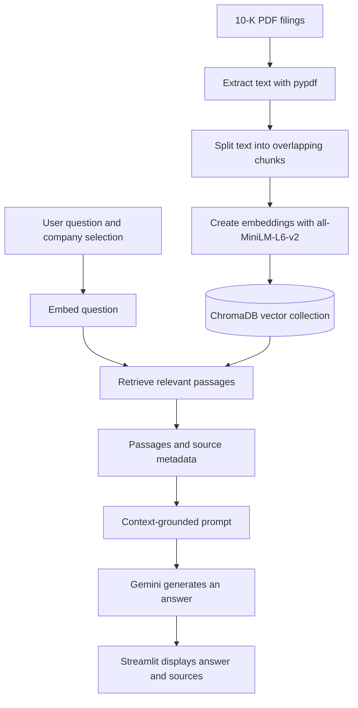

# 10-K Intelligence

A RAG-based research assistant for exploring SEC Form 10-K annual reports from Amazon, NVIDIA, Starbucks, and JPMorgan Chase.

**Live demo:** https://10k-intelligence.streamlit.app/

---

## Overview

Annual reports are long and difficult to search manually. This app lets users ask questions about the four indexed filings, explore risks and financial performance, and compare selected companies. Answers are generated from retrieved filing passages and include source labels.

## Features

- Ask questions about one or more selected companies.
- Retrieve relevant passages from indexed 10-K filings.
- Compare information across selected companies.
- Generate context-grounded responses with Gemini.
- Display source labels to help trace answers back to filings.
- Use a Streamlit chat interface with suggested questions.

## How it works



### Retrieval pipeline

1. **Extract:** `pypdf` reads text from the company filings.
2. **Chunk:** The text is split into overlapping character-based chunks.
3. **Embed:** `all-MiniLM-L6-v2` converts chunks into 384-dimensional vectors.
4. **Store:** ChromaDB stores vectors, text, and source metadata.
5. **Retrieve:** The question is embedded with the same embedding model, and ChromaDB searches the selected companies' documents.
6. **Generate:** Gemini receives the retrieved passages and instructions to answer from that context.
7. **Display:** Streamlit shows the response and source labels.

## Chunk-size experiment

The local experiment produced these results:

| Chunk size (characters) | Chunks created | Easy-set source hit rate | Hard-set source hit rate |
|---:|---:|---:|---:|
| 400 | 6,850 | 100% | 100% |
| 800 | 3,425 | 100% | 100% |
| 1,600 | 1,713 | 95% | 100% |

The project uses **800 characters per chunk with 150 characters of overlap**. In this experiment, the 800-character setting matched the 400-character setting's source hit rates while producing about half as many chunks.

**Evaluation note:** Source hit rate checks whether the expected filing appears in the retrieved results. It is not the same as end-to-end answer accuracy or proof that every generated claim is correct. The test set is limited, so these results should be treated as an initial evaluation.

## Tech stack

| Tool | Role |
|---|---|
| Python | Application and indexing logic |
| Streamlit | Web interface |
| pypdf | PDF text extraction |
| Sentence-Transformers | Text embeddings |
| `all-MiniLM-L6-v2` | Embedding model |
| ChromaDB | Vector storage and retrieval |
| Google Gemini | Answer generation |
| python-dotenv | Local environment-variable loading |

## Run locally

### 1. Clone the repository

```bash
git clone https://github.com/ayush-antil/10k-Intelligence-Rag.git
cd 10k-Intelligence-Rag
```

### 2. Install dependencies

```bash
pip install -r requirements.txt
```

### 3. Configure your API key

Create a local `.env` file in the project root:

```text
GEMINI_API_KEY=your_key_here
```

Keep your real API key private. Do not commit `.env` or `.streamlit/secrets.toml` to GitHub.

For Streamlit Community Cloud, add `GEMINI_API_KEY` under the app's **Settings → Secrets**.

### 4. Start the app

```bash
streamlit run app.py
```

## Rebuild the vector index

Place the source PDFs in `data/` using these filenames:

```text
data/
├── amazon_10k.pdf
├── nvidia_10k.pdf
├── starbucks_10k.pdf
└── jpmorgan_10k.pdf
```

Run the indexing script:

```bash
python 01_build_rag.py
```

The app uses the persisted collection in `chroma_db/`. If you change the chunk size, overlap, embedding model, or relevant indexing code, rebuild the index and test the app against it. Keep a backup before replacing an existing index.

## Repository structure

```text
10k-Intelligence-Rag/
├── app.py                 # Streamlit app and question-answering flow
├── 01_build_rag.py        # PDF processing and vector-index creation
├── requirements.txt       # Python dependencies
├── README.md              # Project overview and setup
├── MODEL_BLUEPRINT.md     # Architecture and data flow
├── INTERVIEW_GUIDE.md     # Technical explanation and interview prep
├── data/                  # Source 10-K PDFs
├── chroma_db/             # Persisted ChromaDB index
└── assets/                # App images and icons
```

## Limitations

- The knowledge base covers only the four included filings.
- PDF extraction may not preserve every table or layout correctly.
- Retrieval can miss relevant passages, and generated answers can still contain mistakes.
- Source labels help with traceability but do not guarantee every statement is supported.
- This project is a research aid, not financial or investment advice.
